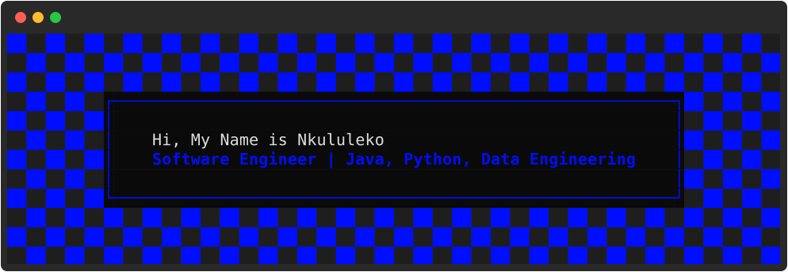

  

**Software engineer (Java, Python) · data engineering · former designer**, based in Johannesburg. Software engineering student at WeThinkCode.

### Selected work
- **[Creator Analytics Dashboard](https://github.com/NkulAIR/creator-analytics-dashboard)**: ELT pipeline that unifies YouTube, Twitch and Patreon data into PostgreSQL, with a Streamlit dashboard. [Demo](https://youtu.be/BU_csaYUBD0)
- **[CollabSpace](https://github.com/NkulAIR/multi-tenancy)**: multi-tenant project management app (Spring Boot, Spring Security, JWT, PostgreSQL, React). Work in progress.
- **[Nkuliverse](https://github.com/NkulAIR/Nkuliverse)**: my design work and portfolio.

### Contact
[Email](mailto:nkululekotshaka10@gmail.com) · [LinkedIn](https://linkedin.com/in/nkululeko-tshaka-040b71128)
